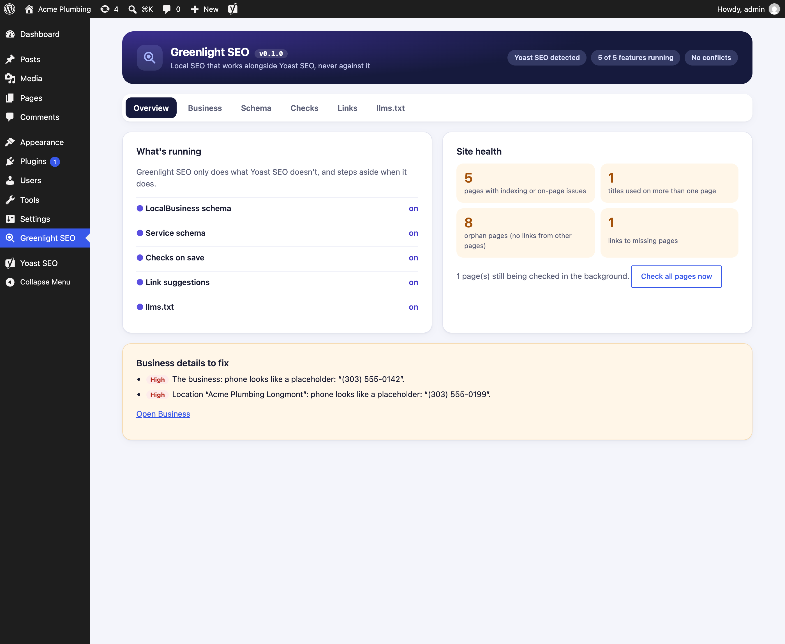
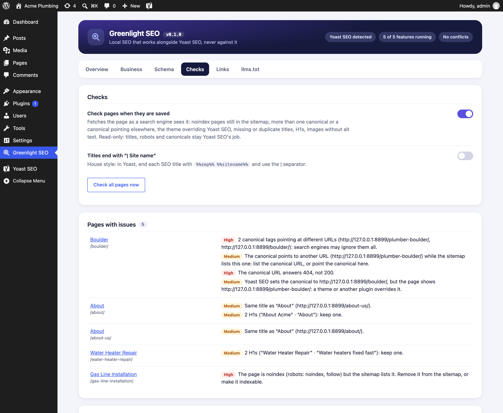
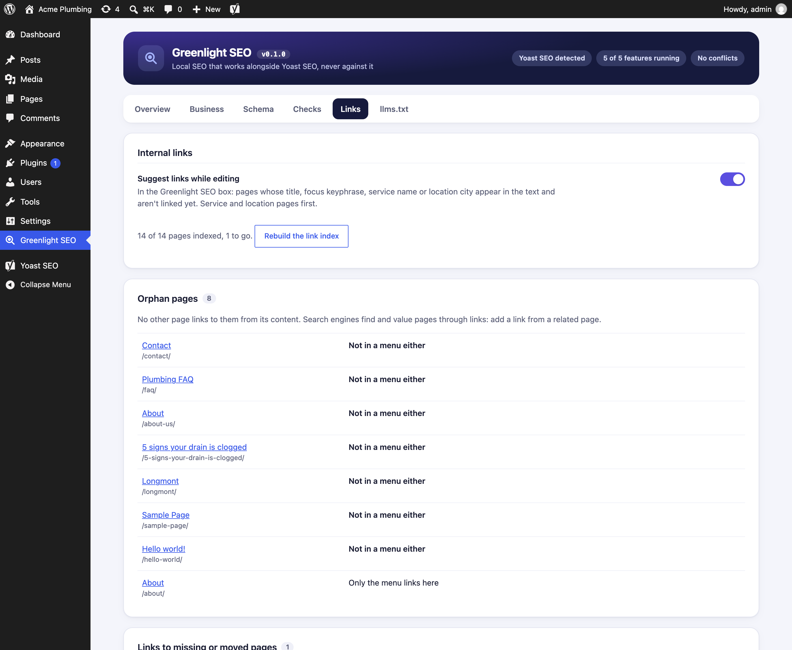
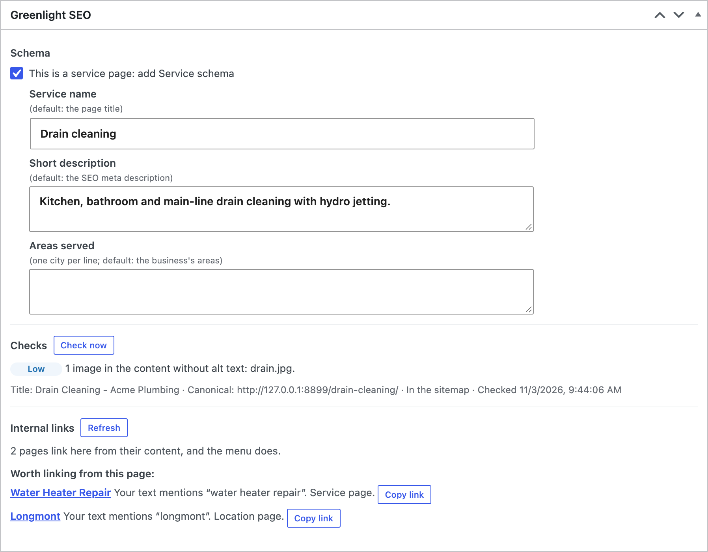

# Greenlight SEO

A WordPress plugin for the local-business SEO that Yoast SEO and Rank Math leave to their paid add-ons, or
don't do at all. It's a companion to [Greenlight](https://github.com/yoborj/greenlight), which handles speed
and security; Greenlight SEO handles the rest of on-site SEO.

**It works alongside the site's SEO plugin, never against it.** Titles, meta descriptions, robots,
canonicals, XML sitemaps, breadcrumbs, the main schema graph, FAQ and How-to blocks, redirects and llms.txt
stay with Yoast SEO or Rank Math. Greenlight SEO adds what they charge for or don't have, and steps aside
when the site already has it.

Requires WordPress 6.3+ and PHP 7.4+. Current version: **0.1.0**
([download](https://github.com/yoborj/greenlight-seo/releases/tag/v0.1.0), [changelog](CHANGELOG.md)).









Screenshots use a made-up demo site.

## What it does

| Area | What it does | Yoast SEO / Rank Math |
|---|---|---|
| **LocalBusiness schema** | The business type (Plumber, Dentist, LegalService…), address, phone, opening hours, coordinates, price range, areas served and profiles, plus one LocalBusiness per other location on its own page, linked to the main business. | Yoast: **Local SEO add-on** (bundled with Premium). Rank Math: Local SEO module. Greenlight SEO steps aside when either is on. |
| **Service schema** | On pages you mark as service pages: the service, its description and areas, provided by the business. | Not in either free plugin. |
| **Indexing checks, on save** | Noindex pages still in the sitemap; more than one canonical, a canonical pointing elsewhere, at a 404 or at a redirect; a theme or plugin overriding the SEO plugin's canonical or adding a noindex; pages that redirect; indexable pages missing from the sitemap. | Neither checks what the page actually outputs. |
| **On-page checks, on save** | Missing, multiple or duplicate titles; not exactly one H1; the H1 being the SEO title word for word; content images without alt text; optionally, titles not ending with "\| Site name". | Yoast's analysis covers the focus keyphrase; Greenlight SEO checks the rendered page and the whole site. |
| **Internal links** | Orphan pages, dead ends, links to missing or redirected pages, the most-linked pages, and link suggestions while editing (service and location pages first). | Yoast: **Premium** (suggestions, orphaned content). Rank Math: suggestions in the free plugin. Suggestions step aside for both. |
| **NAP in one place** | `[greenlight_nap]` prints the name, address, phone, hours or email of the business or any location, from the same settings as the schema. | Yoast: Local SEO add-on. |
| **llms.txt** | Optional `/llms.txt`: the business, services, locations, pages and recent posts, as Markdown links for AI assistants. | Yoast has one (free since 25.3), Rank Math has a module. Greenlight SEO's can't be switched on while theirs is on. |

Not included, on purpose: an **FAQ block** (Yoast SEO and Rank Math have one), **HowTo schema** (Google stopped showing HowTo rich results in 2023), a
**redirect manager** (use the Redirection plugin, which the QA app manages), and anything the SEO plugin
already does.

## How it works with the SEO plugin

Greenlight SEO checks what's active on every request and shows it on the Overview: each feature is **on**,
**off** (switched off), or **stepping aside**, with the reason, e.g. "Yoast SEO Premium suggests internal links
while you write". The Overview also warns about overlapping plugins (All in One SEO, SEOPress, Schema Pro, Link
Whisper, or Yoast and Rank Math active together).

**Schema goes into the SEO plugin's own graph,** so each page still has one JSON-LD graph:

- **Yoast SEO**, site set to an organization with a name and logo: the business is merged into Yoast's
  Organization, which becomes e.g. `["Organization", "Plumber"]` with the address, hours and so on (the way
  Yoast Local SEO does it). Service and location nodes join the graph and point at it.
- **Yoast SEO without an Organization** (no logo, or set to a person): the business joins Yoast's graph as
  a LocalBusiness of its own on its main page; service pages describe their provider inline.
- **Rank Math**: the same, using Rank Math's Organization.
- **Neither**: one `<script type="application/ld+json">` graph of Greenlight SEO's own.

**The checks are read-only.** Titles, robots, canonicals and sitemaps stay the SEO plugin's job. With Yoast,
Greenlight SEO compares what the page shows with what Yoast meant to output, so it can tell a theme overriding
Yoast apart from a Yoast setting.

## Setting it up

1. **Greenlight SEO → Business**: the business name, type, address, phone, hours (one line per rule: `Mo-Fr
   08:00-17:00`, `Sa 09:00-12:00`, `Su closed`), coordinates (5+ decimals), areas served, and profile URLs
   (Google Business Profile, Facebook, Yelp…). Match the Google Business Profile exactly. Add **other
   locations** with their own page. The Overview lists anything Google needs that is missing, placeholder
   values (`555-01xx`, "lorem"…) and hours it can't read.
2. **Service pages**: when editing a service page, tick **This is a service page** in the Greenlight SEO
   box. Its name, description and areas default to the page title, the SEO meta description and the
   business's areas.
3. **Checks → Check all pages now** once. After that, each page is checked when it's saved.
4. Use `[greenlight_nap]` in the footer and on contact and location pages instead of typing the address.

## The editor box

Every public post type gets a **Greenlight SEO** box (block editor, classic editor and page builders):

- **Schema**: the service-page switch and fields; on a location page, which location's schema it carries.
- **Checks**: the page's issues by severity (High, Medium, Low, Note), its title, canonical and whether
  it's in the sitemap. They run again after every save in the block editor, and when the page is opened
  after a change. Saves from page builders, Quick Edit or the REST API are checked in the background.
- **Internal links**: how many pages link here (and whether the menu does), and pages worth linking from
  this one: their title, focus keyphrase, service name or location city appears in the text and isn't
  linked yet. "Copy link" copies the URL.

## Checks in detail

| Check | Severity |
|---|---|
| Noindex, but the sitemap lists the page | High |
| Noindex added by a theme or plugin while the SEO plugin has the page indexable | High |
| Two or more canonical tags pointing at different URLs | High |
| The canonical URL answers 404 or a redirect | High |
| The page redirects but the sitemap lists it | High |
| No `<title>` | High |
| The canonical points to another URL while the sitemap lists this one | Medium |
| The SEO plugin's canonical is overridden | Medium |
| Two `<title>` tags | Medium |
| The same title as another indexable page | Medium |
| No H1, or more than one | Medium |
| Indexable but not in the sitemap | Low |
| No canonical tag | Low |
| The H1 is the SEO title word for word | Low |
| Content images without alt text | Low |
| Title doesn't end with "\| Site name" (optional house style) | Low |

Pages are fetched logged out, the way search engines see them, with a query string that gets past page
caches. While "Discourage search engines" is on (staging), every page is noindex, so noindex checks are
skipped and the page says so. A password-protected staging site answers 401: the checks say they couldn't
fetch the page.

## WP-CLI

```
wp greenlight-seo status [--format=json]
wp greenlight-seo check <id>... | --all [--format=json]
wp greenlight-seo links [<id>]
wp greenlight-seo scan
wp greenlight-seo llms
wp greenlight-seo set <key> <value>
```

- `status`: what's on and what steps aside, business problems, flagged pages, duplicate titles, orphans,
  dead ends, broken and redirected links. With `--format=json`, the output is a contract (`schema: 1`, any
  change bumps it), so the QA app can read it later:

  ```json
  {"greenlight_seo_version":"0.1.0","schema":1,"seo_plugin":"Yoast SEO",
   "features":{"local_schema":{"on":true,"why":null},"link_suggestions":{"on":false,"why":"Yoast SEO Premium suggests internal links while you write"},…},
   "business":{"name":"…","type":"Plumber","has_address":true,"locations":1},
   "problems":[{"severity":"high","message":"…"}],
   "checks":{"flagged_pages":5,"queued":0,"pages":[{"id":8,"url":"…","title":"…","issues":[{"id":"canonical_multiple","severity":"high","text":"…"}]}]},
   "duplicate_titles":[{"title":"about - acme plumbing","urls":["…","…"]}],
   "links":{"pages":13,"indexed":13,"queued":0,"orphans":[{"url":"…","in_menu":false}],"dead_ends":["…"],"broken":[{"from":"…","url":"…"}],"redirected":[]},
   "llms_txt":{"on":true,"url":"…/llms.txt"}}
  ```
- `check`: checks pages now (one HTTP request each) and prints their issues.
- `links`: rebuilds the internal link index now and lists orphans, dead ends, broken and redirected links;
  with an ID, the link suggestions for that page.
- `scan`: queues every page for checks and the link index in the background (WP-Cron, a few at a time).
- `llms`: prints the llms.txt Greenlight SEO would serve.
- `set`: one setting. Switches (1/0): `local_schema`, `service_schema`, `checks_on_save`,
  `check_title_suffix`, `link_suggestions`, `llms_txt`. Business fields: `name`, `type`, `phone`, `email`,
  `street`, `city`, `region`, `postal`, `country`, `lat`, `lng`, `hours`, `price_range`, `area_served`,
  `same_as`, `description`.

## Where it comes from

The checks and schema rules follow the SEO skills in
[dherichsen/david-skills-public](https://github.com/dherichsen/david-skills-public):

- `seo-schema` and its local schema reference: LocalBusiness subtypes, required and recommended fields,
  coordinates to 5 decimals, areas served for service-area businesses, one LocalBusiness per location
  linked to the main business, Service on service pages, deprecated types (Attorney → LegalService) and
  rich results Google retired (HowTo).
- `onpage-seo`: one H1 that isn't the raw SEO title, the "\| Site name" title suffix, NAP from one central
  setting.
- `seo-interlink` and `seo-links`: orphans, dead ends, links to redirected or missing pages, service and
  location ("money") pages first.
- `seo-sitemap`: noindex pages in the sitemap.
- `seo-geo`: llms.txt.

The rest of those skills (content writing, briefs, topic clusters, competitor and backlink analysis,
keyword research, Google Business Profile and map rankings) need outside data or judgment, so they stay
Claude workflows rather than plugin features.

## Install

Download `greenlight-seo-<version>.zip` from the [GitHub releases](https://github.com/yoborj/greenlight-seo/releases)
and upload it under Plugins → Add New → Upload, or unzip it to `wp-content/plugins/greenlight-seo/`.
Settings are under **Greenlight SEO** in the wp-admin menu. On activation the link index builds in the
background; run **Checks → Check all pages now** once.

Deleting the plugin removes its settings, its indexes and the per-page data it stored (check results,
links, the service-page fields).

## Releasing

Bump `Version:` in `greenlight-seo.php` and `GREENLIGHT_SEO_VERSION`, add a CHANGELOG entry, commit, tag
`vX.Y.Z`, then build the zip from the tag (`.gitattributes` keeps docs and dotfiles out of it):

```
git archive --format=zip --prefix=greenlight-seo/ -o greenlight-seo-X.Y.Z.zip vX.Y.Z
gh release create vX.Y.Z greenlight-seo-X.Y.Z.zip --title "Greenlight SEO X.Y.Z" --notes-file <changelog entry>
```
